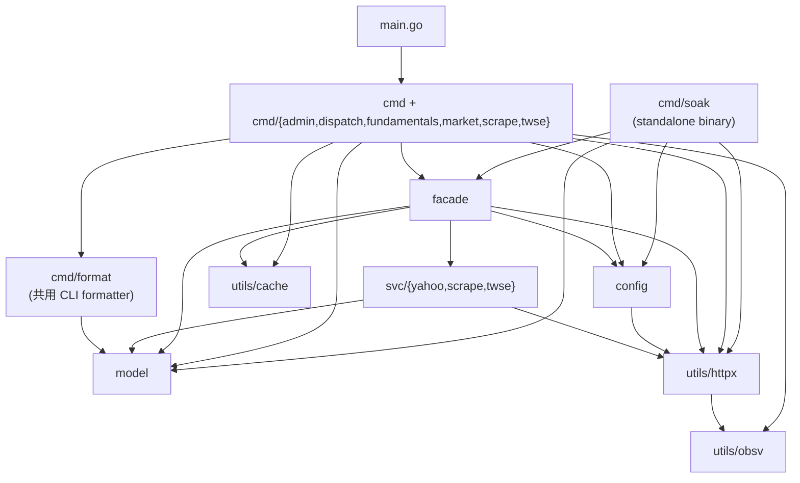

# CLAUDE.md - Technical Context

## 🚀 Commands

### Build & Run

- **Build CLI**: `go build -o yfin .`
- **Install CLI**: `go install .`
- **Run CLI**: `./yfin --help` or `go run .`

### Test & Lint

- **Unit Tests**: `go test ./...`
- **Integration Tests**: `go test -tags=integration ./...`
- **Coverage**: `go test -coverprofile=coverage.out ./...`
- **Lint**: `go vet ./...`（如已安裝亦可執行 `golangci-lint run`）
- **Format**: `go fmt ./...`

---

## 🗂️ Project Structure

Module path: `github.com/bizshuk/yfin` (曾用名 `yfinance-go`).

文件分流：進行中 implementation plans 位於 [plans/](plans/)；純過期 plan 直接刪除，完成且仍有 durable specification value 的內容移至 [docs/specs/](docs/specs/)；只有需長期遵守的 hard decisions 才寫入 [docs/memory/](docs/memory/)。領域名詞以 [docs/terminology.md](docs/terminology.md) 為準。

### 依賴圖 (Dependency Graph)

依賴方向嚴格由上往下，無環 (DAG)。`model/`、`utils/obsv` 與 `utils/cache` 是 internal leaf；`config/` 是只依賴 `utils/httpx` type/defaults 的 adapter。

| 層 (Layer) | 套件 (Packages) | 可依賴 (May import) |
| --- | --- | --- |
| leaf | `model`, `utils/obsv`, `utils/cache` | 無 (nothing internal) |
| infra | `utils/httpx` | `utils/obsv` |
| config adapter | `config` | `utils/httpx` |
| service | `svc/{yahoo,scrape,twse}` | `model`, `utils/httpx` |
| facade | `facade` | `svc/*`, `model`, `config`, `utils/httpx`, `utils/cache` |
| cmd | `cmd`, `cmd/*` | `facade`, `model`, `config`, `cmd/format`, `utils/{httpx,cache,obsv}` |
| cmd formatter leaf | `cmd/format` | `model` only |

> `cmd/*` 對 `svc/*` 的 import 邊數為 `0`；由 `TestInternalPackagesFollowDependencyContract` 驗證完整 internal import boundary。

### 套件職責 (Package Responsibilities)

- `facade/`: Publicly exported, reflection-free plain Go structs (e.g. `facade.Bar`, `facade.Quote`) for external packages (e.g., `stock`, `data`) to avoid importing `svc/*` internals. Two constructors: `facade.NewClient()` / `facade.NewClientWithConfig(*httpx.Config)`. The `*Client` is the **single handler** for both external SDK consumers AND the in-repo `yfin` CLI — all data fetching routes through it. `facade.*` DTOs are **type aliases** for `model.*` — a back-compat shim only. `Client` 的方法依 surface 分檔，一檔一職責：
    - `client.go`: `Client` struct（shared HTTP client、MIC cache + `sync.RWMutex`）+ 2 constructors + 共用 helper (`inferMICForSymbol` / `isAuthenticationError`)；`ConfigureScrape` 由 `facade/scrape.go` 在同一 connection pool 套用 YAML scrape policy。
    - `client_profile.go`: facade composition 階段註冊 Yahoo 固定主機 profile；query、web scrape 與 cookie bootstrap 共用一個 connection pool，但各自選用 limiter、body cap、headers 與 endpoint tag。
    - `client_yahoo.go`: 12 個 Yahoo API `Fetch*`：8 個 chart/quoteSummary surface（Daily/Intraday/Weekly/Monthly bars、Quote、FundamentalsQuarterly、CompanyInfo、MarketData）、3 個 annual fundamentals-timeseries statement（Income/Balance/CashFlow）與 news XHR；回傳 plain SDK/model struct。
    - `client_norm.go`: 4 個 `Fetch*Norm` 變體，回傳 `*model.Normalized*`（保留 ScaledDecimal 精度）。
    - `client_scrape.go` + `client_scrape_{financials,profile,statistics}.go`: scrape snapshot、完整 financials/profile/statistics DTO、analysis projection 與 model converter。
    - `foundation.go`: 30-command ordered manifest 與 `FetchFoundation` generic
      dispatch；`cmd/dispatch` 與 downstream SDK consumer 共用，不再各自複製
      command-to-provider mapping。
    - `cached_client.go` / `cached_twse.go` / `cached_foundation.go` /
      `raw_cache.go`: downstream 傳入 raw root；yfin 擁有 read-through policy、
      request identity、atomic JSON persistence 與 legacy artifact reads。
    - `twse.go` / `twse_dispatch.go`: `TwseClient` 不透明 handle（含建構、`Dispatch`、no-data 判定）/ endpoint registry + 23 個 fetcher map。
- `svc/`: SDK-first business services (HTTP fetch + decode + validation only):
    - `svc/yahoo/`: Yahoo Finance raw HTTP API client（Crumb auth、chart API、quoteSummary、annual fundamentals-timeseries、news XHR）。`timeseries.go` 將最新 annual point 映射為 `model.FundamentalsSnapshot`；`news.go` 將 `tickerStream` 映射為 `[]model.NewsItem`。Endpoint envelope 留在 service 內，不穿越 facade boundary。
    - `svc/scrape/`: Web scraping engine (robots.txt compliant, fills API gaps). Owns HTTP/parse logic + scrape-config types (`Config`/`EndpointConfig`/`RobotsPolicy`/`RegexConfig`)；HTTP defaults 由 `utils/httpx.DefaultScrapeConfig()` 單一擁有。DTOs 以 `model.*` types 穿越 layer。News 抽取依職責拆為 orchestration、JSON strategy、normalization、regex config 與 metrics。
    - `svc/twse/`: Taiwan Stock Exchange open data client + parsers (23 endpoints). Owns HTTP/fetch logic + `Registry`/`Dispatcher`/`Fetcher`/`Endpoint` meta; the 23 `*Response` envelope structs and `*Row` typed rows are re-exported as `model.*` aliases for cross-layer reuse.
- `model/`: Pure data types + normalization logic — the **lowest layer** of the dependency graph. Houses: 8 facade-aligned SDK DTOs (`Bar`/`BarBatch`/`Quote`/`MarketData`/`CompanyInfo`/`FundamentalsSnapshot`/`FundamentalsLine`/`NewsItem`), `ScaledDecimal` precision type + helpers, `Security` + `InferMIC` + `CreateSecurity` + `ExchangeToMIC`, 11 `Normalized*` types + 6 `Converted*` + `ConvertTo` methods + `FXConverter`/`FXMeta`/`MockFXConverter`, 5 raw Yahoo normalization functions (`NormalizeBars`/`Quote`/`Fundamentals`/`MarketData`/`CompanyInfo`), exchange-local `ToTradingDay` plus the deprecated UTC-only compatibility helper, scrape DTOs (`FetchMeta`/`ScrapeNewsItem`/`NewsStats`/value types/`Scaled` alias/`Currency` alias/`YahooNum`/`YahooInt`/`YahooString`/all comprehensive DTOs), TWSE `Response` envelope + 22 endpoint `*Response` + `*Row` types, and `scrape_convert.go` (DTO→model direct converters: `ScrapeFinancialsToSnapshot`/`BalanceSheet`/`CashFlow`/`KeyStatistics`/`Analysis`/`AnalystInsights` + `ScrapeNewsToItems`). **`svc/norm/` was merged into `model/`** in Phase 2; `svc/norm/` no longer exists.
- `utils/`: Shared infrastructure (`utils/*` may NOT import `svc/*`):
    - `utils/httpx/`: Resilient HTTP client — 單一共享 `http.Client` 與 connection pool，依 hostname 選用 immutable `HostProfile` 的 limiter、response body cap、request defaults 與 endpoint tag；未註冊主機沿用 `Config`。Breakers 仍獨立依 authority 加 optional context-only logical group 分組，不與 profile identity 合併。每個含 retries 的 logical request 只記錄一次最終 outcome；session rotation 已移除。
    - `utils/cache/`: Root-confined atomic JSON store 與 refresh-frequency cache
      (daily/monthly/quarterly/annually)，以最新有效 artifact 判 freshness。
    - `utils/obsv/`: Structured logging (stdlib `slog`) + OpenTelemetry no-op tracer + active HTTP Prometheus metrics。已移除的 publisher/session pipeline 不得保留 spans、metrics 或 dashboards。
- `config/`: Top-level YAML loader (`os.ReadFile` + `yaml.Unmarshal` into `map[string]interface{}`, then env-var interpolation + struct mapping + validation) — `config.Config` / `config.NewLoader` / `config.CreateEffectiveConfig`。一個 config section 一個檔案；`loader.go` 只管讀檔與插值，`adapters.go` 只管轉成 HTTP/scrape/FX 下游型別。只可 import `utils/httpx`，不得 import `svc/*`。runtime 預設設定 `effective.yaml` 與 source 同目錄（不同環境以 `app.env` 分流）。
- `cmd/`: CLI composition root. `main.go` calls each sub-package's `Register(RootCmd)`:
    - `cmd/{root,client,global,logging,build,exitcodes}.go`: helpers + persistent flags + log precedence + shared client builders（皆回傳 `*facade.Client`）。
    - `cmd/admin/`: `config`, `version`.
    - `cmd/dispatch/`: `batch` (sub-package name is `dispatch` but no top-level
      `yfin dispatch` command exists)。命令順序取自
      `facade.FoundationCommands()`，全部呼叫 `FetchFoundation`；embedded
      universe 位於 `cmd/dispatch/ticker_list.csv`，atomic artifacts 寫入
      `~/.config/yfin/data/raw/`；任一 `failed` command 令 CLI 回 non-zero。
    - `cmd/format/`: **共用** 的 comprehensive-\* DTO → stdout formatter（`ComprehensiveStatistics` / `ComprehensiveProfile` / `ComprehensiveFinancials`），一個 DTO 一個檔案。`cmd/fundamentals` 與 `cmd/scrape` 都由此取用；此套件只 import `model/`，是 leaf。
    - `cmd/fundamentals/`: `fundamentals`, `comprehensive-stats`, `comprehensive-profile`.
    - `cmd/market/`: `pull`, `quote`；多 symbol fetch 使用保留輸入順序的 bounded worker pool，worker 數為 CLI/YAML global limit、YAML per-host limit 與 item count 的最小值。
    - `cmd/scrape/`: `scrape` (3 mutually-exclusive modes: `--check` / `--preview-json` / `--preview-news`；`--preview` 是 check output flag)。
    - `cmd/twse/`: `twse` (23 endpoints with `--endpoint` / `--date` / `--stock` / `--month` flags). 只 import `facade`；TWSE client 是 `*facade.TwseClient` 不透明 handle，dispatch 走 `client.Dispatch(ctx, endpoint, date, opts)`。
    - `cmd/soak/`: Standalone binary `soak` (invoked via `go run ./cmd/soak`, NOT `yfin soak`)；loaded config 與 CLI overrides 建立單一 facade client，failure injection 包在 shared HTTP transport，`auto` 只允許 `fundamentals → financials` fallback。
    - `cmd/samples/`, `cmd/tools/`: scripts + golden fixtures.

> CLI tree is **flat** (`yfin pull`, `yfin quote`, ...) — there are no nested groups. `cmd/market/` is the Go sub-package directory name, not a user-facing group.
>
> **Architecture contract: `cmd → facade → svc → model`** (model is the lowest layer; svc depends on model; facade depends on svc + model; cmd depends on facade + model). The yfin CLI's runtime code never calls `svc/*` directly — every fetch goes through `cmd.CreateClient()` or `cmd.CreateClientFromConfig()`（皆回傳 `*facade.Client`），再包裝 `facade.NewClientWithConfig()`。已載入 typed YAML 的 command 使用 `CreateClientFromConfig()`，讓 client 與 command policy 共用同一 snapshot。HTTP CLI overrides (`--qps` / `--retry-max` / `--timeout`) 由 shared builder 套在 YAML HTTP settings 上；`--log-level` 由 root/observability composition consume，`--concurrency` 只由 `cmd/market` 的 multi-item orchestration consume。Cmd sub-packages (`market` / `fundamentals` / `scrape` / `dispatch` / `twse`) only interact with `svc/yahoo` / `svc/scrape` / `svc/twse` through facade's plain-SDK methods or facade-level wrappers (`(*facade.Client).ScrapeFetch` / `(*facade.TwseClient).Dispatch` / `facade.YahooDispatch` etc.). `model/*` imports in cmd ARE allowed (DTOs as formatter parameters). Scrape DTOs convert to model directly via `model.Scrape*ToSnapshot` / `model.ScrapeNewsToItems` (in `model/scrape_convert.go`). External packages (stock, data) call `facade.NewClient()` directly or import `model/` for raw types.
>
> **facade 不得在簽名上洩漏 `svc/*` 的具體型別。** 若 facade 回傳裸的 `*svc/twse.Client`，cmd 光是為了宣告變數就被迫 import `svc/twse`，契約當場破功（此事發生過）。跨越 facade 邊界的 handle 一律包成 facade 自有的不透明型別（如 `facade.TwseClient`），並把操作掛成它的 method。純資料的 re-export（`type TwseEndpoint = twse.Endpoint`、`var TwseRegistry`）可以，因為 alias 讓 cmd 不必 import svc 就能指名該型別。
>
> **Downstream cache ownership contract:** Stock 等 consumer 可提供自己的
> app raw root，但不得自行實作 Yahoo/TWSE transport 或 raw persistence。
> `NewCachedClient`、`NewCachedTwseClient`、`NewCachedFoundationClient` 與
> `NewRawCache` 是唯一支援的 cache boundary。決策記錄見
> [downstream cache ownership](docs/memory/2026-07-29-downstream-cache-ownership.md)。

> **Why yahoo raw shapes are now in `model/`** — yahoo raw-shape structs (`ChartBar`/`RawQuote`/`ChartMeta`/`Fundamentals`/`IncomeStatement`/etc.) live in `model/yahoo_raw.go`. svc/yahoo imports `model/` (one-way only), decoders return `*model.ChartResponse`/`*model.QuoteResponse`/`*model.FundamentalsResponse` directly, and `yahoo.X` aliases in `svc/yahoo/*.go` keep callers compiling unchanged. There is no cycle because `model/` does not import `svc/yahoo`.

---

## 🔧 Code Conventions & Decisions

1. **No Session Rotation**: Session rotation was removed to simplify HTTP connection reuse and state management. The HTTP client uses one shared `http.Client`; host profiles independently select rate limits, body caps, headers, and endpoint tags. Circuit breakers remain keyed by authority + optional logical group. `--sessions` persistent flag remains for backward compatibility but its effect is vestigial.
2. **Facade boundary (legacy)**: External projects (stock, data, ...) may import from `facade/` for the legacy back-compat surface OR from `model/` directly for raw types. The recommended path is `model/` since `facade/` types are now just aliases. **Avoid `ScaledDecimal` in external surfaces** — use float64 via `model.Bar`/`model.Quote`/etc.
3. **Decimals**: Prices/amounts are internally stored as `ScaledDecimal` for precision in `model.Normalized*` types. External-facing `model.Bar`/`model.Quote`/etc. expose float64. Conversion between the two is `model.FromScaledDecimal(sd)`.
4. **Timezones**: Store boundaries and event times in UTC, but derive a daily bar's calendar date from the Yahoo exchange timezone via `model.ToTradingDay()`. `model.ToUTCDayBoundaries()` remains only as a deprecated UTC compatibility helper.
5. **`cmd → facade → svc → model` strict path**: The yfin CLI's runtime code (`cmd/**/*.go`) MUST NOT call any `svc/*` package directly. All data fetching goes through `cmd.CreateClient()` / `cmd.CreateClientFromConfig() → *facade.Client`; all dispatch (YahooDispatch / ScrapeFetch / `(*TwseClient).Dispatch` / Parse*) goes through `facade/`. `model/*` imports in cmd ARE allowed (DTOs as formatter parameters; scrape DTO→model conversion lives in `model/scrape_convert.go`). New code in `cmd/` that needs a `svc/*` capability should expose a facade wrapper first rather than importing `svc/*`. Internal dependency direction 由 `TestInternalPackagesFollowDependencyContract` 驗證。
6. **model/ lowest-layer rule**: `model/` does NOT import `svc/*`, `facade/`, or `cmd/`. All raw-shape structs consumed by `Normalize*` (ChartBar, RawQuote, ChartMeta, Fundamentals, IncomeStatement, etc.) live in `model/yahoo_raw.go`. svc/yahoo decoders return `*model.ChartResponse`/`*model.QuoteResponse`/`*model.FundamentalsResponse` directly, so the cycle is broken.
7. **External SDK objects decode at upper layer**: When integrating a third-party SDK whose data shapes don't naturally fit `model/`, the decode/translate step happens in `facade/` (or a dedicated handler), NOT in `model/`. `model/` only owns shapes that result from such decode. The rationale: `model/` should stay import-cycle-free at the bottom of the stack; pushing decode upstream keeps the layer rule simple.
8. **一檔一職責 (one file, one responsibility)**: 一個檔案只回答一個問題。判準不是行數，是「這檔在做幾件事」——`model/twse.go`(412 行、45 個 type) 是單一型別目錄，合格；而 744 行的舊 `extract_news.go` 同時管 regex 設定、Prometheus 指標、HTML 解析、JSON 解析與去重，就該拆。設定載入、觀測性接線、解析策略、值正規化屬於**不同**職責，不得混在同一檔。大型 `Client` 的方法依 surface 分檔（見 `facade/client_*.go`）。
9. **禁止跨套件複製貼上 (no copy-paste across packages)**: 兩個 `cmd/*` 子套件需要同一段邏輯時，把它下沉成共用 leaf 套件（如 `cmd/format/`），不要為了「避免 cross-package dependency」而複製。複製過的程式碼一定會 drift——`cmd/scrape` 與 `cmd/fundamentals` 的 formatter 曾有 264 行逐字重複並已開始分歧。
10. **Chart absence semantics**: A structurally valid Yahoo chart response may omit currency metadata or contain zero observations. Daily-bar validation still requires symbol/OHLCV integrity when rows exist, but it does not invent currency and does not turn an empty series into a transport error. `NormalizeBars` preserves symbol/MIC/provider-first-trade metadata in an empty `BarBatch`; downstream applications with official market context own any currency fallback and no-data evidence.
11. **Normalized metadata identity**: `model.Meta.Source="yfin"` and `Producer="local"` identify the runtime producer consistently across normalized surfaces. Legacy `ampy.*` values in `SchemaVersion` / golden `schema_fqdn` are serialized-shape compatibility identifiers only；它們不代表 protobuf dependency 或 publisher pipeline。
12. **Fundamentals absence semantics**: Quarterly quoteSummary normalization derives `AsOf` from the latest accepted `PeriodEnd`。Missing period dates invalidate the statement；provider payload 未提供 currency 時保留 empty string，不得猜測 `USD`。Snapshot `Source` 使用 `yahoo-finance` 表示 provider lineage。
13. **Scrape absence semantics**: Financials、key statistics 與 analysis parsers 只保留 source HTML 明確提供的 currency；缺值維持 empty string，不以 `USD` 補造。所有 scrape DTO 的 `AsOf` 使用 UTC。

### Exit Codes (cmd/exitcodes.go)

`0=Success, 1=GeneralError, 2=PaidFeatureRequired, 3=ConfigError`.

### Persistent Flags (cmd/global.go)

`--config`, `--log-level`, `--run-id`, `--concurrency`, `--qps`, `--retry-max`, `--sessions` (vestigial), `--timeout`, `--observability-disable-tracing`, `--observability-disable-metrics`.

### Dependencies

Dependency versions 由 `go.mod` / `go.sum` 單一擁有；文件不得複製可由 `go list -m all` 量測的版本快照。
