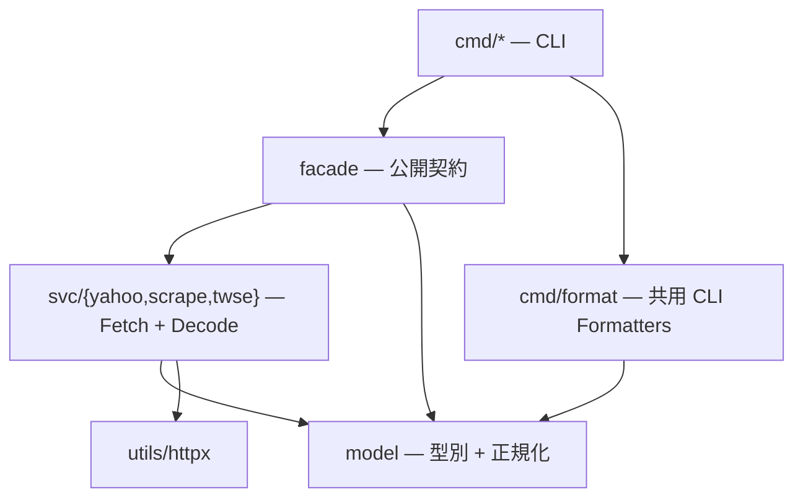

# yfin — Yahoo Finance Client for Go

[](https://golang.org/)
[](LICENSE)
[](https://goreportcard.com/report/github.com/bizshuk/yfin)
[](https://godoc.org/github.com/bizshuk/yfin)

> ⚠️ **重要免責聲明 (IMPORTANT DISCLAIMER)** ⚠️
>
> **本專案與 Yahoo Finance 或 Yahoo Inc. 無任何關聯、未獲其背書或贊助。**
>
> 本專案為**獨立的開源 Go Client**，存取公開的 Yahoo Finance HTTP Endpoints 與網頁。Yahoo Finance 未為此資料提供官方支援的 API 契約，因此 Endpoint 或頁面結構變更可能會導致 Client 無法運作。
>
> **使用風險請自負 (Use at your own risk)。** Yahoo Finance 可能隨時變更其網站結構，從而破壞此 Client 的運作。我們對資料準確性、可用性或是否符合 Yahoo Finance 服務條款不作任何保證。
>
> **法律聲明 (Legal Notice)：** 使用者有責任確保使用本軟體符合 Yahoo Finance 的服務條款及其所在司法管轄區的適用法律。

---

## 🎯 解決的問題 (Problem We're Solving)

**痛點與挑戰：** 多數金融資料 Client 常遇到資料格式不一致、API 不穩定以及錯誤處理欠佳的問題。開發金融應用程式時，開發者常面臨：

- **資料格式不一致 (Inconsistent Data Formats)**：不同的 API 回傳各種不同結構與格式的資料
- **浮點數精度問題 (Floating Point Precision Issues)**：金融計算需要極為精確的 Decimal 精度
- **Rate Limiting 問題**：無限制的 Request 會導致 API 封鎖與 Throttling
- **錯誤處理欠佳 (Poor Error Handling)**：缺乏完善的 Retry 邏輯與 Circuit Breaking 機制
- **幣別轉換複雜 (Currency Conversion Complexity)**：經常缺少多幣別支援或存在 Bug
- **缺乏標準化 (No Standardization)**：每個 Client 都有各自的資料結構與慣例

**我們的解決方案：** 生產級 (Production-grade) 的 Go Client，提供：

✅ **標準化資料格式 (Standardized Data Formats)** — 每個概念提供單一規範的 `model.*` 結構，無論來源為 API 或 Web Scrape
✅ **高精度 Decimal (High Precision Decimals)** — 用於金融精確度的 Scaled Decimal 運算
✅ **強健的 Rate Limiting** — 內建 Backoff、Circuit Breakers 與 QPS 限速
✅ **多幣別支援 (Multi-Currency Support)** — 搭配 FX Provider 自動進行幣別轉換
✅ **Production Ready** — 完整的錯誤處理、可觀測性 (Observability) 與監控
✅ **易於整合 (Easy Integration)** — 同時支援 Library 與 CLI 介面的簡潔 API

---

## 🚀 安裝說明 (Installation)

### 作為 Go Module 使用

```bash
go get github.com/bizshuk/yfin
```

### 從源碼編譯 (From Source)

`package main` 位於 repo 根目錄 — 不存在 `cmd/yfin` 目錄。

```bash
git clone https://github.com/bizshuk/yfin.git
cd yfin
go build -o yfin .
```

---

## 🧱 架構 (Architecture)

依賴方向嚴格由上往下 (DAG)，`model/` 位於最底層，不 Import 任何內部套件。



契約嚴格為 `cmd → facade → svc → model`。CLI 從不直接存取 `svc/*`；每一次 Fetch 皆透過 `facade.Client`，這也是外部 Consumer 使用的相同 Handle。這意味著 CLI 能做的所有事情，你的程式碼也能做到 — 不存在特權的內部路徑。

下游 Packages 應 Import `facade/`（便利性，`float64` 價格）或 `model/`（Raw 型別，`ScaledDecimal` 精度），切勿 Import `svc/*`。

規範的領域術語定義於 [docs/terminology.md](docs/terminology.md)。

---

## 📖 快速開始 (Quick Start)

### 基本用法 (Basic Usage)

```go
package main

import (
    "context"
    "fmt"
    "log"
    "time"

    "github.com/bizshuk/yfin/facade"
)

func main() {
    // 建立新的 client（使用預設 HTTP 設定）
    client := facade.NewClient()
    ctx := context.Background()

    // 抓取 Apple 的 Daily Bars
    start := time.Date(2024, 1, 1, 0, 0, 0, 0, time.UTC)
    end := time.Date(2024, 1, 31, 0, 0, 0, 0, time.UTC)

    // facade 回傳使用 float64 價格的 plain structs — 無需處理 ScaledDecimal 運算
    batch, err := client.FetchDailyBars(ctx, "AAPL", start, end, true, "my-run-id")
    if err != nil {
        log.Fatal(err)
    }

    fmt.Printf("Fetched %d bars for %s\n", len(batch.Bars), batch.Symbol)
    for _, bar := range batch.Bars {
        fmt.Printf("Date: %s, Close: %.4f %s\n",
            bar.Date, bar.Close, bar.CurrencyCode)
    }
}
```

---

## 🔧 API 參考 (API Reference)

### Client 建立 (Client Creation)

```go
// 使用標準設定的預設 client
client := facade.NewClient()

// 自訂 HTTP 設定 (QPS, retries, timeout, circuit breaker)
client := facade.NewClientWithConfig(&httpx.Config{ /* ... */ })
```

### 可用功能 (Available Functions)

#### 📊 歷史資料 (Historical Data)

**FetchDailyBars** — 取得 Daily OHLCV 資料

```go
bars, err := client.FetchDailyBars(ctx, "AAPL", start, end, adjusted, runID)
```

**FetchIntradayBars** — 取得 Intraday 資料 (1m, 5m, 15m, 30m, 60m)

```go
bars, err := client.FetchIntradayBars(ctx, "AAPL", start, end, "1m", runID)
```

> **注意：** Intraday 資料可能不支援所有 Symbol，部分 Request 可能會回傳 HTTP 422 錯誤。

**FetchWeeklyBars** — 取得 Weekly OHLCV 資料

```go
bars, err := client.FetchWeeklyBars(ctx, "AAPL", start, end, adjusted, runID)
```

**FetchMonthlyBars** — 取得 Monthly OHLCV 資料

```go
bars, err := client.FetchMonthlyBars(ctx, "AAPL", start, end, adjusted, runID)
```

#### 💰 即時資料 (Real-time Data)

**FetchQuote** — 取得當前市場 Quote

```go
quote, err := client.FetchQuote(ctx, "AAPL", runID)
```

**FetchMarketData** — 取得綜合市場資料 (Comprehensive Market Data)

```go
marketData, err := client.FetchMarketData(ctx, "AAPL", runID)
```

#### 🏢 公司資訊 (Company Information)

**FetchCompanyInfo** — 取得基本公司資訊

```go
companyInfo, err := client.FetchCompanyInfo(ctx, "AAPL", runID)
```

**FetchFundamentalsQuarterly** — 取得 Quarterly Financials（需要付費訂閱）

```go
fundamentals, err := client.FetchFundamentalsQuarterly(ctx, "AAPL", runID)
```

Annual Statements 使用免費的 fundamentals-timeseries Endpoint：

```go
income, err := client.FetchIncomeStatement(ctx, "AAPL")
balance, err := client.FetchBalanceSheet(ctx, "AAPL")
cashflow, err := client.FetchCashFlowStatement(ctx, "AAPL")
news, err := client.FetchNews(ctx, "AAPL")
```

#### Read-through Raw Cache

下游應用程式可選擇由 App 擁有的 Raw Root；yfin 負責 Provider 存取、Cache Identity、Refresh Policy、Path Validation 與 Atomic Writes。

```go
barsClient, err := facade.NewCachedClient(rawRoot)
twseClient, err := facade.NewCachedTwseClient(rawRoot)
foundationClient, err := facade.NewCachedFoundationClient(rawRoot)

bars, err := barsClient.FetchDailyBars(ctx, "AAPL", start, end, true, runID)
artifact, err := foundationClient.Fetch(
    ctx, "info", "AAPL", runID, false,
)
```

Cache 結構佈局為：

```text
yahoo/bars/<symbol>/<start>_<end>_<adjusted>.json
twse/<endpoint>/<date>_<query-sha256>.json
<foundation-command>/<ticker>.<YYYY-MM-DD>.json
```

`facade.FoundationCommands()` 回傳包含 30 個 Command 的有序清單。`FetchFoundation` 與 `CachedFoundationClient.Fetch` 將通用的 Foundation Dispatch 保留在 SDK 內部，而非由下游應用程式各自實作。

---

## 🗂️ Facade 層 (Reflection-free Plain Go Structs)

`facade` 套件將正規化後的 Yahoo Finance Models（Bars, Quotes, Company Info, Market Data, Fundamentals, News）暴露為 Plain Go Structs，價格欄位使用 `float64`、時間戳使用標準 `time.Time`，而非內部的 `ScaledDecimal` 表示法。外部 Consumer 應直接使用 `facade.Client` — 無需手動轉換。

`facade.Client` 是下游 Packages（`stock`, `data` 等）的**公開契約 (Public Contract)**。它也是 CLI 在內部透過 shared `cmd` client builders 所使用的相同 Handle。

### 使用範例 (Usage Example)

```go
package main

import (
    "context"
    "fmt"
    "log"
    "time"

    "github.com/bizshuk/yfin/facade"
)

func main() {
    client := facade.NewClient()
    ctx := context.Background()

    // facade.Client 直接回傳 plain structs — 無需處理 ScaledDecimal 運算
    batch, err := client.FetchDailyBars(ctx, "AAPL",
        time.Now().AddDate(0, 0, -5), time.Now(), true, "run-id")
    if err != nil {
        log.Fatal(err)
    }

    fmt.Printf("Symbol: %s (MIC=%s)\n", batch.Symbol, batch.MIC)
    for _, bar := range batch.Bars {
        // Close 直接是 float64
        fmt.Printf("Date: %s, Close: %.2f %s\n",
            bar.Date, bar.Close, bar.CurrencyCode)
    }
}
```

### 可用公開型別 (Available Public Types)

- `*facade.BarBatch` — `{Symbol, MIC, []Bar}`；每個 `Bar` 包含 `Date` (UTC `YYYY-MM-DD`)、`Open/High/Low/Close` (`float64`)、`Volume int64`、`Adjusted bool`、`CurrencyCode string`。
- `*facade.Quote` — `{Symbol, Price float64, Currency, EventTime time.Time}`。
- `*facade.CompanyInfo` — Security Metadata 的字串透傳 (`Symbol`, `LongName`, `Exchange`, `Currency`, `Timezone` ...)。
- `*facade.MarketData` — 可為 Null 的 `*float64` 價格欄位 + `*int64` 交易量；`nil` 代表缺失（非零）。
- `*facade.FundamentalsSnapshot` — 透過 fundamentals-timeseries 的 Annual Statements 或透過付費 quoteSummary Surface 的 Quarterly Fundamentals。
- `[]facade.NewsItem` — `{Title, URL, Source, Summary, PublishedAt, Symbols}`。

針對已持有 `*model.Normalized*` 數值的呼叫端，亦有導出原始的 `FromBarBatch` / `FromQuote` / `FromCompanyInfo` 轉換器，但新撰寫的程式碼應優先使用直接回傳 Plain Structs 的 `facade.Client` 方法。

需要 `ScaledDecimal` 精度而非 `float64`？請使用 `Norm` 變體 — `FetchDailyBarsNorm` / `FetchQuoteNorm` / `FetchFundamentalsNorm` / `FetchMarketDataNorm` — 它們會在正規化步驟停止並回傳 `*model.Normalized*` 型別。

---

## 🕸️ Scrape Fallback 系統

對於仍缺乏 stdlib 相容 JSON Endpoint 的欄位，yfin 提供顯式的 Web-scraping 方法並搭配相同的 Model 型別。呼叫端可直接選擇這些 `Scrape*` 方法；不存在隱式的 API 到 Scrape 的自動切換。

### 核心功能 (Key Features)

- **自動後備機制 (Automatic Fallback)**：流暢地在 API 與 Scrape 之間切換
- **資料一致性 (Data Consistency)**：無論資料來源為何，輸出格式完全相同
- **生產安全性 (Production Safety)**：遵守 robots.txt，實作適當的 Rate Limiting
- **涵蓋範圍完整 (Comprehensive Coverage)**：存取無法透過免費 API 取得的資料

### 支援的 Scrape Endpoints

- **Key Statistics**：本益比 (P/E ratios)、市值 (Market cap)、財務指標
- **Financials**：損益表 (Income statements)、資產負債表 (Balance sheets)、現金流量表 (Cash flow)
- **Analysis**：完整的分析師資料，包含：
    - Earnings estimates (當前/下一季，當前/下一年)
    - EPS trends (當前估算，7/30/60/90 天前)
    - EPS revisions (過去 7/30 天的上修/下修)
    - Revenue estimates (季度與年度)
    - Growth estimates
- **Analyst Insights**：目標價 (Target prices)、推薦評級 (Recommendations)、分析師人數
- **Profile**：公司資訊、高階主管、業務摘要
- **News**：近期新聞文章與新聞稿

### 快速 Scrape 範例 (Quick Scrape Examples)

```go
// Scrape key statistics（無法透過免費 API 取得）
keyStats, err := client.ScrapeKeyStatistics(ctx, "AAPL", runID)

// Scrape financial statements
financials, err := client.ScrapeFinancials(ctx, "AAPL", runID)

// Scrape comprehensive analysis data (earnings trends, EPS revisions, revenue estimates)
analysis, err := client.ScrapeAnalysis(ctx, "AAPL", runID)

// Scrape analyst insights (target prices, recommendations)
analystInsights, err := client.ScrapeAnalystInsights(ctx, "AAPL", runID)

// Scrape news articles
news, err := client.ScrapeNews(ctx, "AAPL", runID)
```

### CLI Scraping

```bash
# 預覽 Scrape key statistics
yfin scrape --check --ticker AAPL --endpoint key-statistics --preview

# 多個 Endpoints 並以 JSON 輸出
yfin scrape --ticker AAPL --endpoints key-statistics,financials,news --preview-json

# Soak testing 為獨立的 binary，而非 yfin 子指令
go run ./cmd/soak --universe-file universe.txt --duration 2h --qps 5
```

📖 **[完整 Scrape 文件 →](docs/scrape/overview.md)**

---

## 📝 使用範例 (Usage Examples)

### 範例 1：抓取多個 Symbol 的 Daily Bars

```go
package main

import (
    "context"
    "fmt"
    "log"
    "sync"
    "time"

    "github.com/bizshuk/yfin/facade"
)

func main() {
    client := facade.NewClient()
    ctx := context.Background()

    symbols := []string{"AAPL", "GOOGL", "MSFT", "TSLA"}
    start := time.Date(2024, 1, 1, 0, 0, 0, 0, time.UTC)
    end := time.Date(2024, 1, 31, 0, 0, 0, 0, time.UTC)

    var wg sync.WaitGroup
    results := make(chan string, len(symbols))

    for _, symbol := range symbols {
        wg.Add(1)
        go func(sym string) {
            defer wg.Done()

            batch, err := client.FetchDailyBars(ctx, sym, start, end, true, "batch-run")
            if err != nil {
                results <- fmt.Sprintf("Error fetching %s: %v", sym, err)
                return
            }

            results <- fmt.Sprintf("%s: %d bars fetched", sym, len(batch.Bars))
        }(symbol)
    }

    wg.Wait()
    close(results)

    for result := range results {
        fmt.Println(result)
    }
}
```

### 範例 2：取得當前市場 Quote

```go
package main

import (
    "context"
    "fmt"
    "log"

    "github.com/bizshuk/yfin/facade"
)

func main() {
    client := facade.NewClient()
    ctx := context.Background()

    quote, err := client.FetchQuote(ctx, "AAPL", "quote-run")
    if err != nil {
        log.Fatal(err)
    }

    fmt.Printf("Symbol: %s\n", quote.Symbol)
    fmt.Printf("Price: %.4f %s\n", quote.Price, quote.Currency)
    fmt.Printf("Event Time: %s\n", quote.EventTime.UTC().Format("2006-01-02 15:04:05"))
}
```

### 範例 3：取得公司資訊 (Fetch Company Information)

```go
package main

import (
    "context"
    "fmt"
    "log"

    "github.com/bizshuk/yfin/facade"
)

func main() {
    client := facade.NewClient()
    ctx := context.Background()

    info, err := client.FetchCompanyInfo(ctx, "AAPL", "company-run")
    if err != nil {
        log.Fatal(err)
    }

    fmt.Printf("Company: %s\n", info.LongName)
    fmt.Printf("Exchange: %s\n", info.Exchange)
    fmt.Printf("Full Exchange: %s\n", info.FullExchangeName)
    fmt.Printf("Currency: %s\n", info.Currency)
    fmt.Printf("Instrument Type: %s\n", info.InstrumentType)
    fmt.Printf("Timezone: %s\n", info.Timezone)
}
```

### 範例 4：錯誤處理 (Error Handling)

```go
package main

import (
    "context"
    "fmt"
    "log"
    "time"

    "github.com/bizshuk/yfin/facade"
)

func main() {
    client := facade.NewClient()
    ctx := context.Background()

    // 帶有適當錯誤處理的 Data Fetch
    batch, err := client.FetchDailyBars(ctx, "AAPL",
        time.Date(2024, 1, 1, 0, 0, 0, 0, time.UTC),
        time.Date(2024, 1, 31, 0, 0, 0, 0, time.UTC),
        true, "error-handling-run")

    if err != nil {
        log.Printf("Error fetching bars: %v", err)
        return
    }

    fmt.Printf("Successfully fetched %d bars\n", len(batch.Bars))

    // 處理空結果
    if len(batch.Bars) == 0 {
        fmt.Println("No data available for the specified date range")
        return
    }

    // 處理資料 — Bar.Close 為標準 float64
    for _, bar := range batch.Bars {
        fmt.Printf("Date: %s, Close: %.4f %s\n",
            bar.Date, bar.Close, bar.CurrencyCode)
    }
}
```

`FetchDailyBars` 可成功回傳 Metadata 完整但 `Bars` 為空的 Batch，表示 Yahoo 已處理該 Symbol/Window、期間內沒有 Observation；呼叫端不得將其改寫成虛構價格。Yahoo 偶爾也會在有效 Chart Response 省略 Currency，此時 Bar 的 `CurrencyCode` 保持空字串，應由擁有官方 Market Context 的下游補值。

---

## 🐍→🦫 Batch Mode (Python yf parity)

`yfin batch` 以 Go 實作 `skills/scripts/all_ticker_yf.py` 的 30-command 批次、分級快取與 Artifact Lifecycle；Python 版本只保留為明確執行的 Live Oracle，不屬於 Stock Runtime：

- `commandOrder` 取自 `facade.FoundationCommands()`；CLI Registry 與 SDK Consumer 都呼叫 `FetchFoundation`。
- 預設 Universe 由 Binary Embedded `cmd/dispatch/ticker_list.csv` 提供，不依賴 Working Directory。
- CLI Artifacts 寫入 `~/.config/yfin/data/raw/<command>/<ticker>.<YYYY-MM-DD>.json`。下游可把自己的 App Raw Root 傳給 `NewCachedFoundationClient`；Artifact 仍由 yfin 寫入。
- JSON 與 Error Artifacts 皆以同目錄 Temporary File + Atomic Rename 發布；Cache 只以最新有效 Artifact 判斷 Freshness。
- HTTP `404/422` 記為 `not_found`；任何 `failed` Command 會保留已成功的 Artifacts，並使 Batch Exit 回傳非零值。

```bash
# 預設：抓取 embedded universe 中所有 ticker × 30 指令
go run . batch

# 單股 / 強制重抓 / 調整並行數
go run . batch --ticker 2330.TW
go run . batch --ticker 2330.TW --force
go run . batch --max-workers 5

# Live semantic gate：Python oracle → Go batch → 30-command comparator
./scripts/verify-yf-parity.sh AAPL
./scripts/verify-yf-parity.sh 2330.TW
```

對應 Python 端說明：見 `skills/SKILL.md` 的 `## Go client parity gate`。

### 30-command 實作矩陣 (30-command implementation matrix)

下表只表示 Go command 已接線到對應資料來源，不等同 live parity 已通過。release 前必須以 `scripts/verify-yf-parity.sh` 對 AAPL 與 2330.TW 驗證 artifact 存在、JSON validity、empty semantics 與 top-level type；Yahoo rate limit 或頁面變更會讓 gate 以 non-zero 明確失敗。

| 指令                                                                                                     | 來源 (Python)                                     | Go 端實作                                             | 接線 |
| -------------------------------------------------------------------------------------------------------- | ------------------------------------------------- | ----------------------------------------------------- | ---- |
| info                                                                                                     | 5 quoteSummary 模組                               | `(*yahoo.Client).FetchInfo`                           | ✅   |
| history                                                                                                  | chart 30d/daily                                   | `(*facade.Client).FetchDailyBars` 30d                 | ✅   |
| actions                                                                                                  | chart events                                      | `(*yahoo.Client).FetchActions`                        | ✅   |
| income / balance / cashflow                                                                              | fundamentals-timeseries annual API                | `FetchIncomeStatement/BalanceSheet/CashFlowStatement` | ✅   |
| major-holders / institutional-holders / mutualfund-holders                                               | quoteSummary 7 模組(單次 HTTP)                    | `FetchHolders`(同 4 模組)                             | ✅   |
| insider-transactions / insider-roster                                                                    | quoteSummary                                      | `FetchInsider`                                        | ✅   |
| insider-purchases                                                                                        | netSharePurchaseActivity 整形為 label/value table | `InsiderPurchaseSummaryTable`                         | ✅   |
| recommendations / recommendations-summary                                                                | 同源(quoteSummary)                                | `FetchRecommendationTrend`                            | ✅   |
| upgrades                                                                                                 | quoteSummary                                      | `FetchUpgrades`                                       | ✅   |
| earnings-dates                                                                                           | **HTML scrape** `/calendar/earnings?symbol=`      | `(*yahoo.Client).FetchEarningsDates`                  | ✅   |
| earnings-history / eps-trend / eps-revisions / earnings-estimates / revenue-estimates / growth-estimates | quoteSummary                                      | `ScrapeAnalysisDimension`                             | ✅   |
| price-targets                                                                                            | quoteSummary                                      | `ScrapeAnalystInsights`                               | ✅   |
| news                                                                                                     | `POST /xhr/ncp` tickerStream                      | `FetchNews`                                           | ✅   |
| calendar                                                                                                 | quoteSummary `calendarEvents`                     | `FetchCalendar`                                       | ✅   |
| sec-filings                                                                                              | quoteSummary                                      | `FetchSecFilings`                                     | ✅   |
| sustainability                                                                                           | quoteSummary `esgScores`                          | `FetchESG`                                            | ✅   |
| isin                                                                                                     | business-insider                                  | `FetchISIN`                                           | ✅   |
| options                                                                                                  | `/v7/finance/options/`                            | `FetchOptions`                                        | ✅   |
| metadata                                                                                                 | 1d chart(不重抓)                                  | `FetchMetadata`(1d range)                             | ✅   |

---

## 📚 文件指南 (Documentation)

> **注意：** 最新的 Release Notes 請參閱 [Release Notes](docs/history/releases/RELEASE_NOTES.md)。完整變更紀錄請參閱 [CHANGELOG.md](docs/CHANGELOG.md)。

### 核心文件 (Core Documentation)

- **[安裝指南](docs/getting-started/install.md)** — 環境設定與安裝步驟
- **[使用指南](docs/cli/usage.md)** — 詳細的使用範例與模式
- **[API 參考](docs/api/reference.md)** — 完整的 API 文件，含方法能力與限制
- **[資料結構](docs/api/data-structures.md)** — 詳細的資料結構指南與欄位命名規範
- **[完整範例](docs/api/examples.md)** — 包含資料處理與錯誤處理的可執行程式碼範例

### 方法比較與遷移 (Method Comparison & Migration)

- **[方法比較](docs/comparisons/method-comparison.md)** — 方法對照表與使用情境指南
- **[遷移指南](docs/integrations/migration-guide.md)** — 從 Python yfinance 遷移與功能對比

### 錯誤處理與品質 (Error Handling & Quality)

- **[錯誤處理指南](docs/operations/error-handling.md)** — 完整的錯誤處理與疑難排解
- **[資料品質指南](docs/operations/data-quality.md)** — 資料品質預期與驗證規範
- **[效能指南](docs/operations/performance.md)** — 效能最佳化與最佳實踐

### Scrape Fallback 系統

- **[Scrape 概覽](docs/scrape/overview.md)** — 架構與資料流程
- **[設定指南](docs/operations/configuration.md)** — 所有設定選項與最佳實踐
- **[CLI 使用說明](docs/scrape/cli.md)** — 命令列介面範例
- **[疑難排解](docs/operations/error-handling.md)** — 常見問題與解決方案

### 營運與監控 (Operations & Monitoring)

- **[可觀測性指南](docs/operations/observability.md)** — Metrics, Logging 與 Monitoring
- **[Soak Testing 指南](docs/cli/soak-testing.md)** — 負載測試與驗證
- **[Production Readiness 報告](docs/history/production-readiness.md)** — 生產就緒評估與檢查清單

### 開發與測試 (Development & Testing)

- **[測試實作](docs/history/testing-implementation.md)** — 測試策略與實作細節
- **[發行指南](docs/history/releases/RELEASE_GUIDE.md)** — 發行流程與步驟
- **[Release Notes](docs/history/releases/RELEASE_NOTES.md)** — 版本發行說明與 Changelog

### 稽核與品質保證 (Audit & Quality Assurance)

- **[最終稽核摘要](docs/history/audit/FINAL_AUDIT_SUMMARY.md)** — 生產就緒稽核與已套用的修正 (2025-01-30)

### 運營人員 Runbooks (Operator Runbooks)

- **[Scrape Fallback Runbook](monitoring/runbooks/scrape-fallback.md)** — 運營操作步驟
- **[Incident Response Playbook](monitoring/runbooks/incident-playbook.md)** — 緊急應變步驟

### 範例與程式碼範本 (Examples & Code Samples)

- **[Library 範例](facade/samples/)** — Go 程式碼範例與模式
- **[CLI 範例](cmd/samples/)** — 開箱即用的 Shell 腳本
- **[API 使用範例](facade/samples/api_usage/api_usage.go)** — 基本 API 使用方式
- **[歷史資料範例](facade/samples/historical_data/historical_data_example.go)** — 時序資料處理範例

---

## 🖥️ CLI 使用說明 (CLI Usage)

`yfin` CLI 工具提供對所有功能的命令列存取：

> **注意：** 未指定 `--config` 時會載入 `config/effective.yaml`；自訂設定檔時使用 Global Flag `--config <path>`。

### 安裝 (Installation)

```bash
# 從源碼編譯 (package main 位於 repo 根目錄)
go build -o yfin .

# 或全域安裝
go install github.com/bizshuk/yfin@latest
```

### 基本指令 (Basic Commands)

```bash
# 抓取單一 Symbol 的 Daily Bars
yfin pull --ticker AAPL --start 2024-01-01 --end 2024-12-31 --adjusted split_dividend --config config/effective.yaml

# 從檔案讀取多個 Symbol 並抓取資料
yfin pull --universe-file symbols.txt --start 2024-01-01 --end 2024-12-31 --out json --out-dir ./out --config config/effective.yaml

# 取得當前 Quote
yfin quote --tickers AAPL --config config/effective.yaml

# 取得 Fundamentals（需要付費訂閱）
yfin fundamentals --ticker AAPL --preview --config config/effective.yaml
```

### Scraping 指令 (Scraping Commands)

```bash
# Scrape key statistics（無法透過免費 API 取得）
yfin scrape --check --ticker AAPL --endpoint key-statistics --preview --config config/effective.yaml

# 多個 Endpoints 搭配 JSON 預覽
yfin scrape --ticker AAPL --endpoints key-statistics,financials,analysis --preview-json --config config/effective.yaml

# 新聞文章預覽
yfin scrape --ticker AAPL --endpoint news --preview-news --config config/effective.yaml

# Endpoints 健康檢查
yfin scrape --ticker AAPL --endpoint key-statistics --check --config config/effective.yaml
```

### Soak Testing 指令 (Soak Testing Commands)

`soak` 為**獨立的 Binary**，而非 `yfin` 的子指令 — 請使用 `go run ./cmd/soak` 執行。

```bash
# 快速 Smoke Test (10 分鐘)
go run ./cmd/soak --universe-file tests/testdata/universe/soak.txt --endpoints key-statistics,news --duration 10m --concurrency 8 --qps 5 --config config/effective.yaml

# 完整 Production Soak Test (2 小時)
go run ./cmd/soak --universe-file tests/testdata/universe/soak.txt --endpoints key-statistics,financials,analysis,profile,news --duration 2h --concurrency 12 --qps 5 --config config/effective.yaml
```

### CLI 選項 (CLI Options)

#### 核心選項 (Core Options)

- `--ticker` — 欲抓取的單一 Symbol
- `--universe-file` — 包含 Symbol 清單的檔案
- `--start`, `--end` — 日期範圍 (UTC)
- `--adjusted` — 復歸調整策略 (`raw` | `split_dividend`)；預設為 YAML 設定中的 `markets.default_adjustment_policy`（CLI Flag 會覆蓋 YAML 預設值）
- `--out`, `--out-dir` — 本地匯出格式 (`json`) 與輸出目錄
- `--concurrency` — `pull` universe 與 multi-ticker `quote` 的並行 Request 上限；仍受 YAML `per_host_workers` 限制
- `--qps` — 每秒 Request 限制 (Requests Per Second)
- `--retry-max`, `--timeout` — HTTP Retry 次數與 Timeout 調校

#### Scraping 選項 (`yfin scrape`)

- `--endpoint` — 欲 Scrape 的單一 Endpoint (`profile`, `key-statistics`, `financials`, `balance-sheet`, `cash-flow`, `analysis`, `analyst-insights`, `news`)
- `--endpoints` — 以逗號分隔的 Endpoint 清單，用於 `--preview-json`
- `--check` — 僅檢查連線狀態（不進行 Parsing）
- `--preview` — 顯示預覽（不進行 Parsing）
- `--preview-json` — 跨 Endpoints 的 JSON 預覽
- `--preview-news` — 預覽新聞文章
- `--force` — Deprecated compatibility flag；`scrape` 本身已是 explicit surface，因此目前無額外效果

#### Soak Testing 選項 (`go run ./cmd/soak`)

- `--duration` — 測試持續時間（例如：2h, 30m）
- `--endpoints` — 執行的 Endpoints
- `--fallback` — 後備策略 (Fallback Strategy)
- `--memory-check` — 啟用記憶體洩漏檢測 (Memory Leak Detection)
- `--probe-interval` — 正確性 Probe 間隔
- `--failure-rate` — 用於測試的模擬失敗率

📖 **[完整 CLI 文件 →](docs/scrape/cli.md)**

---

## 🎯 使命與成功標準 (Mission & Success Criteria)

**使命 (Mission)**
在 Go 中提供**可靠、一致且快速**的 Yahoo Finance Client，每個概念皆具備單一規範形狀 (`model.*`)，使得 Ingestion Pipeline 與研究工具無論資料來自 API 或網頁 Scraping，皆能看到完全一致的資料。

**成功標準 (Success Criteria)**

- Library 回傳**經過驗證的 `model.*` Structs**，具備正確的 UTC 時間、幣別語義與調整標記。
- CLI 支援即時 Pull 與 Batch Backfill；營運人員可透過單一指令進行 **Dry-run** 與 **Preview**，並本地匯出為 JSON。
- 透過 Concurrency 與 Backoff 控制使 **Error Rates** 與 **429/503** 回應維持在 Policy 規範內；Throughput 可調校且可預測。
- Observability 呈現 Latency/Throughput、Decode Failure 與 Backoff 行為；Alerts 可即時捕捉 Regression。

---

## 📊 資料涵蓋範圍 (Data Coverage)

### ✅ 支援的資料型別 (Supported Data Types)

- **歷史 K 線 (Historical Bars)** — Daily, Weekly, Monthly 及 Intraday OHLCV 資料
- **即時報價 (Real-time Quotes)** — 當前市場價格、買賣價 (Bid/Ask)、成交量
- **公司資訊 (Company Information)** — 基本公司明細、交易所資訊、產業/類股 (Industry/Sector)
- **市場資料 (Market Data)** — 52 週高低價區間、市場狀態、交易時間
- **多幣別支援 (Multi-Currency Support)** — 搭配 FX Provider 自動進行幣別轉換

### ⚠️ 混合 API 與顯式 Scrape 涵蓋範圍

年度財務報表與新聞具備一等 JSON Endpoint 方法。其他詳細資料 Surface 可透過顯式的 `client.Scrape*` 方法取得：

- **財務報表 (Financial Statements)** — `FetchIncomeStatement`, `FetchBalanceSheet`, `FetchCashFlowStatement`
- **分析師推薦 (Analyst Recommendations)** — 目標價、評級
- **關鍵統計數據 (Key Statistics)** — 本益比、市值、財務指標
- **公司概況 (Company Profiles)** — 業務摘要、高階主管、產業資訊
- **新聞文章 (News Articles)** — `FetchNews`

### ⚠️ 通用 Foundation Surfaces

這些 Surface 未各自提供一等的 `Fetch*` 方法。請使用 `yfin batch --ticker X`、`client.FetchFoundation(...)` 或基於 Cache 的 `CachedFoundationClient.Fetch(...)`：

- **選擇權資料 (Options Data)** — 選擇權鏈 (Options chains) 與定價
- **內部人交易 (Insider Trading)** — 交易紀錄、人員名冊、購買摘要
- **機構持股 (Institutional Holdings)** — 主要 / 機構 / 共同基金持有人
- **公司事件 (Corporate Events)** — 行事曆、SEC 申報文件、永續發展 (ESG)、評級調升 (Upgrades)、ISIN

### ❌ 不支援的項目 (Not Supported)

- **Level 2 市場資料** — 最佳委買委賣價量 (Order book)、買賣深度

### 🌍 支援的市場 (Supported Markets)

- **美股市場 (US Markets)** — NYSE, NASDAQ, AMEX
- **國際市場 (International)** — 全球主要交易所
- **外匯與加密貨幣 (Currencies)** — Forex 對與加密貨幣
- **大宗商品 (Commodities)** — 黃金、石油、農產品
- **指數 (Indices)** — S&P 500, Dow Jones, NASDAQ Composite

---

## ⚡ 關鍵功能 (Key Features)

### 🛡️ Production Ready

- **Rate Limiting** — 內建 QPS 限制與 Burst 控制
- **Circuit Breakers** — 滑動視窗失敗檢測，具備明確的 Yahoo Endpoint-family 隔離
- **Retry 邏輯** — 指數退避 (Exponential Backoff) 搭配 Jitter
- **Scrape Surface** — 針對 API 缺口提供符合 robots.txt 規範的顯式 Scrape 方法
- **可觀測性 (Observability)** — 完整的 Metrics, Logs 與 Tracing
- **Soak Testing** — 內建負載測試與強健性驗證

### 💰 金融精確度 (Financial Accuracy)

- **高精度 Decimal** — Scaled Decimal 運算確保計算精確
- **幣別支援 (Currency Support)** — 支援自動轉換的多幣別機制
- **公司行動 (Corporate Actions)** — 股票分割與配息調整 (Split and Dividend Adjustments)
- **交易時間 (Market Hours)** — 正確處理交易時段與節假日

### 🚀 高效能 (Performance)

- **並行 Request (Concurrent Requests)** — 可設定的 Goroutine Pools
- **連線池 (Connection Pooling)** — 高效的 HTTP 連線重用
- **快取機制 (Caching)** — 外匯匯率的內建回應快取
- **批次處理 (Batching)** — 高效的資料 Batching 與 Chunking

### 🔧 開發者體驗 (Developer Experience)

- **簡潔 API** — 清晰、直覺的 Go 介面
- **型別安全 (Type Safety)** — 強型別資料結構
- **錯誤處理** — 完整的 Error Types 與訊息
- **CLI 工具** — 用於營運操作的命令列介面
- **完整文件** — 豐富的範例與 API 文件

---

## 📋 資料格式與規範 (Data Formats & Conventions)

1. **時間 (Time)**：所有時間戳皆為 **UTC** ISO‑8601。Bars 使用 `start` 包含 (Inclusive)、`end` 不包含 (Exclusive)；`event_time` 位於 K 線收盤時間。
2. **精度 (Precision)**：價格與金額皆為 **Scaled Decimals** (`scaled`, `scale`)。交易量為整數 (Integers)。
3. **幣別 (Currency)**：貨幣欄位與財務報表項目皆附加 **ISO‑4217** 代碼。
4. **識別碼 (Identity)**：使用 `SecurityId` = `{ symbol, mic?, figi?, isin? }`。若 MIC 未知，優先使用主要上市推導；請記錄 Fallback 規則。
5. **調整 (Adjustments)**：Bars 宣告 `adjusted: true|false` 與 `adjustment_policy_id: "raw" | "split_only" | "split_dividend"`。
6. **血統/追蹤 (Lineage)**：每條訊息皆包含 `meta.run_id`, `meta.source="yfin"`, `meta.producer="<host|pod>"`, `schema_version`。
7. **批次 (Batching)**：優先使用 `BarBatch` 以提高效率。維護 **Batch 內順序** 依 `event_time` 升冪排列。
8. **相容性 (Compatibility)**：僅限累加式演進；Breaking Changes 需要新的 Major 版本 (`bars.v2`, `fundamentals.v2`)。

### 💰 價格格式化 (Price Formatting)

存在兩種價格表示法，取決於你呼叫的方法：

一般的 `Fetch*` / `Scrape*` 方法回傳 `model.Bar` / `model.Quote` 等，其價格欄位直接是 **`float64`**。無需轉換 — 這也是大多數呼叫端所需：

```go
batch, _ := client.FetchDailyBars(ctx, "AAPL", start, end, true, runID)
fmt.Printf("Price: %.4f %s\n", batch.Bars[0].Close, batch.Bars[0].CurrencyCode)
```

`Fetch*Norm` 方法回傳 `model.Normalized*`，其將價格保持為 **`ScaledDecimal`**（一個整數加上明確的 Scale），因此完全不會損失精度。請使用 `model.FromScaledDecimal` 進行轉換 — 切勿寫死除數：

```go
// ✅ 正確 — 從數值本身讀取 scale
price := model.FromScaledDecimal(bar.Close)

// ❌ 錯誤 — scale 並不總是 4
// price := float64(bar.Close.Scaled) / 10000
```

**範例：** Yahoo 回報 `$221.74` → 儲存為 `{Scaled: 22174, Scale: 2}` → `22174 / 10^2 = 221.74`。

---

## ⚙️ 設定說明 (Configuration)

未指定 `--config` 時，CLI 統一載入 `config/effective.yaml`。先用下列命令檢查插值與 secret redaction 後的 effective config：

```bash
yfin config --print-effective
yfin --config ./config/effective.yaml config --print-effective --json
```

Runtime overrides 使用 Global Flags `--log-level`、`--qps`、`--concurrency`、`--retry-max` 與 `--timeout`；其中 `--concurrency` 只由 `pull` universe 與 multi-ticker `quote` consume。完整 scope、YAML schema 與 precedence 由 [Configuration Reference](docs/operations/configuration.md) 單一擁有。

---

## 🚀 快速開始範例 (Quick Start Examples)

### 執行 CLI 範例

```bash
# 賦予腳本執行權限
chmod +x cmd/samples/*.sh

# 執行 AAPL 預覽範例
./cmd/samples/preview_aapl.sh

# 執行 Soak testing 範例
./cmd/samples/soak_smoke.sh

# 執行 Batch 處理範例
./cmd/samples/batch_processing.sh
```

### 編譯 Library 範例

```bash
# 編譯並執行 Library 範例
go build -o /tmp/scrape_fallback facade/samples/scrape_fallback/scrape_fallback.go
/tmp/scrape_fallback
```

📖 **[Library 範例 →](facade/samples/)** · **[CLI 範例 →](cmd/samples/)**

---

## 🤝 參與貢獻 (Contributing)

我們歡迎透過 GitHub Issues 回報問題或提出變更；提交前請執行下列 Development Checks。

### 開發環境設定 (Development Setup)

```bash
# Clone 儲存庫
git clone https://github.com/bizshuk/yfin.git
cd yfin

# 下載依賴
go mod download

# 執行單元測試
go test ./...

# 編譯 CLI
go build -o yfin .

# 執行整合測試
go test -tags=integration ./...
```

### 程式碼風格 (Code Style)

- 遵循 Go 標準格式化 (`gofmt`)
- 使用具備明確意義的變數與函式名稱
- 為新功能編寫單元測試
- 隨 API 變更同步更新文件

---

## 📄 專案授權 (License)

本專案採用 MIT 授權條款 — 詳細內容請參閱 [LICENSE](LICENSE) 檔案。

---

## 🙏 致謝 (Acknowledgments)

- **Yahoo Finance** 提供公開存取的金融資料
- **Go 社群** 提供優秀的套件與工具
- **貢獻者** 協助改進本專案

---

## 📞 支援與協助 (Support)

- **Issues**: [GitHub Issues](https://github.com/bizshuk/yfin/issues)
- **Discussions**: [GitHub Discussions](https://github.com/bizshuk/yfin/discussions)
- **文件**: [完整文件](docs/)
- **API 參考**: [GoDoc](https://godoc.org/github.com/bizshuk/yfin)

### 尋求協助

1. **查閱文件**：從 [docs/](docs/) 開始閱讀完整的指南
2. **檢視範例**：參考 [facade/samples/](facade/samples/) 與 [cmd/samples/](cmd/samples/) 的程式碼範例
3. **搜尋 Issues**：檢查現有的 [GitHub Issues](https://github.com/bizshuk/yfin/issues)
4. **疑難排解**：參閱 [docs/operations/error-handling.md](docs/operations/error-handling.md)
5. **Runbooks**：營運問題請參閱 [monitoring/runbooks/](monitoring/runbooks/)

---

**⭐ 如果你覺得這個專案有幫助，請在 GitHub 上給我們一個 Star！**
