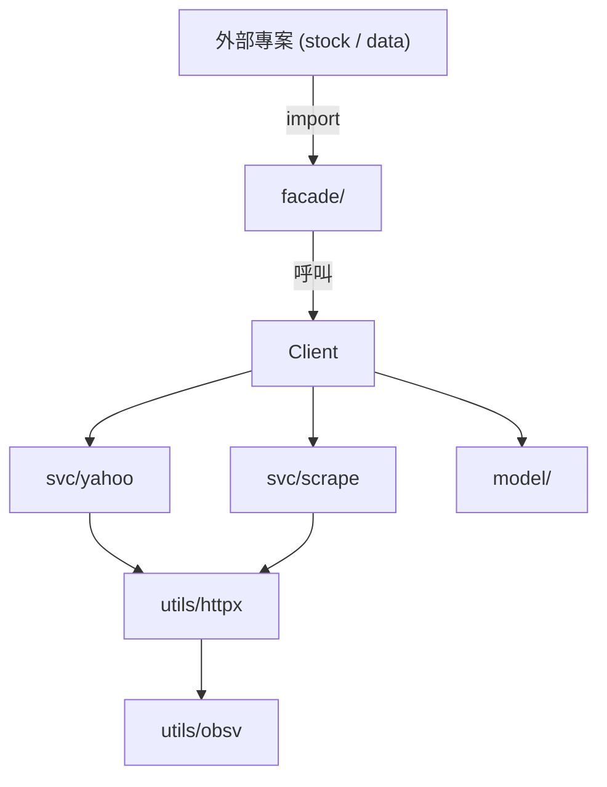

# yfin 入門指南 (Onboarding Guide)

新進成員從零到能送交第一個 PR 的最短路徑。本文件假設你已具備 Go 基礎與終端機操作經驗。

> 專案名稱為 `yfin`，模組路徑 `github.com/bizshuk/yfin`。

---

## 結論優先 (TL;DR)

- 這是 **Yahoo Finance 非官方 Go SDK + CLI**；外部專案優先使用 `model.*` SDK DTO，`facade.*` 保留相同型別的 compatibility aliases。
- 套件劃分嚴格：CLI 只經 `facade/` 呼叫業務服務；`svc/` 包含 `yahoo`、`scrape`、`twse`；`model/` 是最低層；`utils/` 提供 `httpx`、`cache`、`obsv`。
- Typed YAML 預設讀取 `config/effective.yaml`；batch artifacts 使用 `~/.config/yfin/data/`。Observability 提供 structured `slog` 與本機 Prometheus exposition，不自動連接外部 backend。
- 開始工作只需三步：`go test ./...` → `go build -o yfin .` → `./yfin --help`。

---

## 步驟 1：環境準備 (Step 1 — Environment Prerequisites)

### 1.1 Go 版本

模組宣告 `go 1.26.0`，需安裝 Go 1.26 或更新版本。

```bash
go version   # 應顯示 go1.26 或更新
```

### 1.2 取得原始碼

```bash
git clone git@github.com:bizshuk/yfin.git ~/projects/yfin
cd ~/projects/yfin
```

### 1.3 確認外部依賴已就位

`yfin` 主要依賴 `bizshuk/gosdk`（提供 app metadata bootstrap、`slog` 預設 handler 與 Cobra command metric hook）。Typed YAML schema 與 loader 由本 repo 的 `config/` 擁有。首次拉取時 Go modules 會自動下載。

```bash
go mod download   # 預先下載所有依賴
```

### 1.4 設定目錄

設定與 runtime artifacts 分開管理：

```tree
yfin/
└── config/
    └── effective.yaml       # typed YAML 預設輸入

~/.config/yfin/
└── data/
    └── raw/                 # yfin batch atomic artifacts
```

可用 global flag `--config <path>` 指定其他 YAML。需要寫入 batch artifact 時，writer 才會建立對應 data directory；CLI 本身不建立固定 log file。

---

## 步驟 2：建置與冒煙測試 (Step 2 — Build & Smoke Test)

### 2.1 編譯 CLI

```bash
go build -o yfin .
```

產出 `./yfin` 可執行檔。

### 2.2 驗證指令清單

```bash
./yfin --help
```

CLI 是 flat command tree；應看到 `config`、`version`、`batch`、`fundamentals`、`comprehensive-stats`、`comprehensive-profile`、`pull`、`quote`、`scrape`、`twse`。

### 2.3 跑單元測試

```bash
go test ./...
```

### 2.4 整合測試（選用）

```bash
go test -tags=integration ./...
```

整合測試會實際打 Yahoo Finance 與 TWSE 開放資料，需可達外網。

### 2.5 程式碼風格

```bash
go fmt ./...
golangci-lint run
```

---

## 步驟 3：目錄導覽 (Step 3 — Repository Layout)

```tree
yfin/
├── main.go                    # 轉發 cmd.Execute() 的最薄殼（6 個 Register 呼叫）
├── cmd/                       # CLI composition root（cobra）
│   ├── root.go                #   根指令、global flags
│   ├── client.go              #   共用 Client 初始化器
│   ├── global.go              #   全域旗標 + logger 初始化
│   ├── build.go               #   build-time 變數（版本、commit）
│   ├── exitcodes.go           #   退出碼常數
│   ├── admin/                 #   config、version
│   ├── dispatch/              #   批次調度（內部封裝，不暴露 yfin dispatch）
│   ├── fundamentals/          #   fundamentals、comprehensive-stats、comprehensive-profile
│   ├── market/                #   pull、quote
│   ├── scrape/                #   scrape（3 mode）
│   ├── twse/                  #   twse（23 endpoints）
│   ├── soak/                  #   獨立 binary（壓力測試）
│   ├── samples/               #   CLI 子指令範例
│   └── tools/                 #   輔助工具
├── facade/                    # 對外契約層 — 外部專案只 import 這裡
│   ├── client.go              #   公開的 Client 結構 + 建構子
│   ├── bars.go                #   K 線資料 facade
│   ├── quote.go               #   即時報價 facade
│   ├── company_info.go        #   公司資訊 facade
│   ├── fundamentals.go        #   財務報表 facade
│   ├── market_data.go         #   市場資料 facade
│   ├── news.go                #   新聞 facade
│   └── samples/               #   facade 客戶端範例（建議從這裡開始讀）
├── svc/                       # 業務服務層（SDK-first 設計）
│   ├── yahoo/                 #   Yahoo 原始 API 呼叫（Crumb 認證、chart API）
│   ├── scrape/                #   HTML 爬蟲（robots.txt 合規、補 API 缺欄位）
│   └── twse/                  #   台灣證券交易所開放資料
├── model/                     # 純資料型別 + 正規化邏輯（最低層，不 import svc/）
├── utils/                     # 共用基礎設施（utils 不 import svc/*）
│   ├── httpx/                 #   彈性 HTTP：QPS 限流 + 指數退避 + 斷路器
│   ├── cache/                 #   資料更新頻率快取（daily/monthly/quarterly）
│   └── obsv/                  #   OpenTelemetry + Prometheus 指標
├── config/                    # 頂層 YAML config loader（非 internal/）
│   └── effective.yaml         #   環境變數插值後的生效設定（不同環境以 app.env 區分）
├── tests/                     # 測試資產（integration/crosslang/python）
├── monitoring/                # Grafana dashboard + runbooks
├── docs/                      # 文件（本檔所在）
└── skills/                    # agent reference（保留不動）
```

### 設計核心 — 為什麼這樣切？



- `model/` 是建議的 public data surface；`facade/` 提供 client methods 與相同 DTO 的 compatibility aliases。外部專案不應 import `svc/*` 或 `utils/*`。
- `model/` 是最低層的純資料/正規化邏輯，不 import `svc/*` 或 `facade/`。
- `svc/*` 透過 `model/` 共用型別，但彼此不建立橫向依賴；`utils/*` 不應 import `svc/*`。
- CLI（`cmd/` + `main.go`）是 composition root，但 runtime fetch 仍必須遵守 `cmd → facade → svc → model`。

---

## 步驟 4：第一次抓資料 (Step 4 — Your First Fetch)

四行程式碼完成一次 AAPL 日 K 抓取：

```go
package main

import (
    "context"
    "fmt"
    "log"
    "time"

    "github.com/bizshuk/yfin/facade"
)

func main() {
    client := facade.NewClient()
    ctx := context.Background()

    start := time.Date(2026, 1, 1, 0, 0, 0, 0, time.UTC)
    end := time.Date(2026, 1, 31, 0, 0, 0, 0, time.UTC)

    bars, err := client.FetchDailyBars(ctx, "AAPL", start, end, true, "my-run-id")
    if err != nil {
        log.Fatal(err)
    }

    fmt.Printf("Fetched %d bars\n", len(bars.Bars))
}
```

`FetchDailyBars` 的 `adjust` 參數為 `true` 時，會自動套用分割與股利回溯調整。

執行：

```bash
go run ./facade/samples/historical_data
```

---

## 步驟 5：常用工作流程 (Step 5 — Common Workflows)

### 5.1 新增一個 facade 欄位（例如：擴充 `facade.Bar`）

1. 修改 `facade/<file>.go` 加上欄位（**純 struct、無方法、無 reflection**）。
2. 修改 `svc/yahoo/<file>.go` 在解析原始 API 回應時填入該欄位。
3. 修改 `model/<file>.go` 補上 `Normalize*` 邏輯（如需正規化）。
4. 在 `facade/market_data_test.go`（或對應的 `<file>_test.go`）加 golden 測試。
5. `go test ./... && go fmt ./... && golangci-lint run`。

### 5.2 新增一個 CLI command

CLI 子指令採用**子套件自治**模型；不要把所有指令塞在單一 `root.go`。

1. 在 `cmd/<group>/` 建立 `<sub>.go`，定義 `cobra.Command` 並暴露：
   ```go
   func Register(parent *cobra.Command) { parent.AddCommand(NewCmd()) }
   ```
2. 在 `main.go` 增加一行 `cmd/<group>.Register(rootCmd)`。
3. 在 `cmd/<group>/<sub>_test.go` 加 CLI 測試。
4. 更新 `docs/cli/usage.md`。

`admin/`、`fundamentals/`、`market/`、`scrape/`、`twse/` 是內部 ownership folders；它們註冊的 commands 全部直接掛在 root，不能新增同名 nested group。

### 5.3 調整 HTTP 限流參數

1. 修改 `utils/httpx/client.go` 的 `Config` 結構。
2. 修改 `config/effective.yaml` 對應的 YAML 設定。
3. 修改 `config/` 對應 section type 與 `loader.go`，必要時加上驗證。
4. 透過 `utils/obsv/metrics.go` 暴露新指標。

### 5.4 寫整合測試

在 `tests/integration/` 加 `_test.go` 檔，使用 build tag `integration` 標記：

```go
//go:build integration

package integration
```

此檔案只會在 `go test -tags=integration` 時編譯。

---

## 步驟 6：除錯與可觀測性 (Step 6 — Debug & Observability)

### 6.1 日誌輸出

CLI 使用 structured `slog` 寫入 process stderr。若由 PM2、container runtime 或 shell redirect 管理，log retention 與檔案位置由該 deployment owner 決定；`yfin` 不會自行寫固定 log file 或傳送到外部 sink。

### 6.2 指標位置

啟用 `observability.metrics.prometheus.enabled` 時，支援 observability bootstrap 的 commands 會在設定的 bind address 暴露 `/metrics`（development default `:9090`）。這是 pull-based Prometheus exposition，不是 remote push。

`utils/obsv` 目前安裝 no-op OpenTelemetry tracer；YAML 的 OTLP 欄位會被解析與驗證，但尚未建立 exporter。

### 6.3 常見問題

| 症狀                                          | 原因                                          |
| --------------------------------------------- | --------------------------------------------- |
| `authentication failed`                       | Yahoo Crumb 過期 — 等待 cooldown 後重試（`svc/yahoo/auth.go` 會自動處理） |
| HTTP 持續 429                                 | QPS 超過 `Config.QPS` 上限 — 降低 `QPS` 欄位 |
| `facade.Bar` 欄位為零值                       | 該 ticker 在 Yahoo 為 NoneType — 屬正常行為 |
| `tests/integration` 連線逾時                  | 需可達外網，或使用 `mock` 模式               |

---

## 術語解釋 (Terminology)

本專案的特定詞彙，首次出現於其他文件時需搭配本節理解。

| 術語                          | 意義                                                                                                                                              |
| ----------------------------- | ------------------------------------------------------------------------------------------------------------------------------------------------- |
| `facade`                      | 對外契約層（`facade/`）。提供 reflection-free 的 plain struct，外部專案（如 `stock`、`data`）只允許 import 此層，避免直接耦合 SDK 內部實作。   |
| `ScaledDecimal`               | 定點十進位精度模型。內部以 `(Scaled int64, Scale int32)` 表示金額，避免浮點誤差。對外由 `facade` 轉換為 `float64`。                              |
| `svc/`                        | SDK-first 業務服務層。每個子目錄（`yahoo`、`scrape`、`twse`）是一個獨立可單測的服務。                                                              |
| `model/`                      | 純資料型別與正規化邏輯（`ScaledDecimal`、`Normalize*`、scrape DTO 等）。**最低層，不 import `svc/*` 或 `facade/`**。                              |
| `utils/`                      | 共用基礎設施層（`httpx`、`cache`、`obsv`）。**不應 import `svc/*`**。                                                                              |
| `composition root`            | 組合根，唯一可以引用所有層的進入點（`main.go` + `cmd/`）。                                                                                       |
| `Register(parent)`            | CLI 子套件慣例介面：每個 `cmd/<group>/` 暴露一個 `Register(parent *cobra.Command)` 函式，由 `main.go` 註冊至根指令。                              |
| `MIC` (Market Identifier Code) | ISO 10383 市場識別碼。例：`XTAI` = 台灣證交所、`XASE` = 美國 NYSE American。當 API 未提供時，由 `model.InferMIC` 推斷。                           |
| `Crumb`                       | Yahoo Finance 的存取令牌（cookie + crumb 對）。由 `svc/yahoo/auth.go` 管理，會自動刷新並快取。                                                  |
| `norm`                        | 資料正規化：時區統一為 UTC、MIC 推斷、ScaledDecimal 轉換、市場時段判定。位於 `model/` 套件。                                                      |
| `httpx`                       | 彈性 HTTP 客戶端：QPS 限流（token bucket）、指數退避（exponential backoff with jitter）、斷路器（circuit breaker）。                            |
| `obsv`                        | 可觀測性基礎設施：structured `slog`、Prometheus exposition 與 no-op OpenTelemetry tracer boundary。                                                |
| `gosdk`                       | `bizshuk/gosdk`，提供 app metadata bootstrap、預設 `slog` handler 與 Cobra command metric hook。                                                   |
| `robots.txt`                  | 遠端網站爬蟲協定。`svc/scrape/robots.go` 在每次抓取前先請求並快取，僅對被允許的路徑送出請求。                                                   |
| `keep-alive`                  | HTTP/1.1 連線復用。`utils/httpx` 採單一共享 `http.Client` 以最大化連線池利用率（Session rotation 已移除）。                                    |
| `jitter`                      | 退避時的隨機抖動，避免多客戶端同時重試造成的 thundering herd。                                                                                  |

---

## 參考連結 (See Also)

- `README.md` — 業務定義、安裝、快速開始
- `CLAUDE.md` — 技術脈絡、限制、約束
- [套件職責](packages.md)
- [Go API reference](../api/reference.md)
- [CLI usage](../cli/usage.md)
- [Observability](../operations/observability.md)
- [Data quality](../operations/data-quality.md)
- [`facade/samples/`](../../facade/samples/)
- [`cmd/samples/`](../../cmd/samples/)
